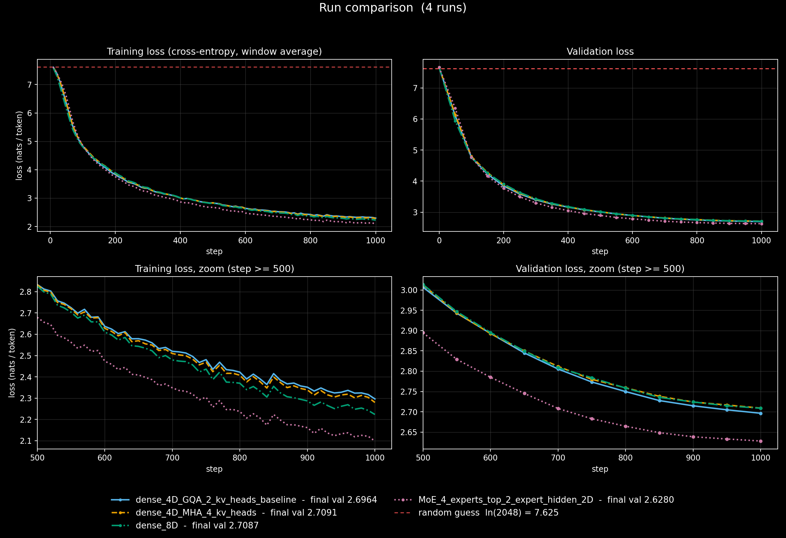
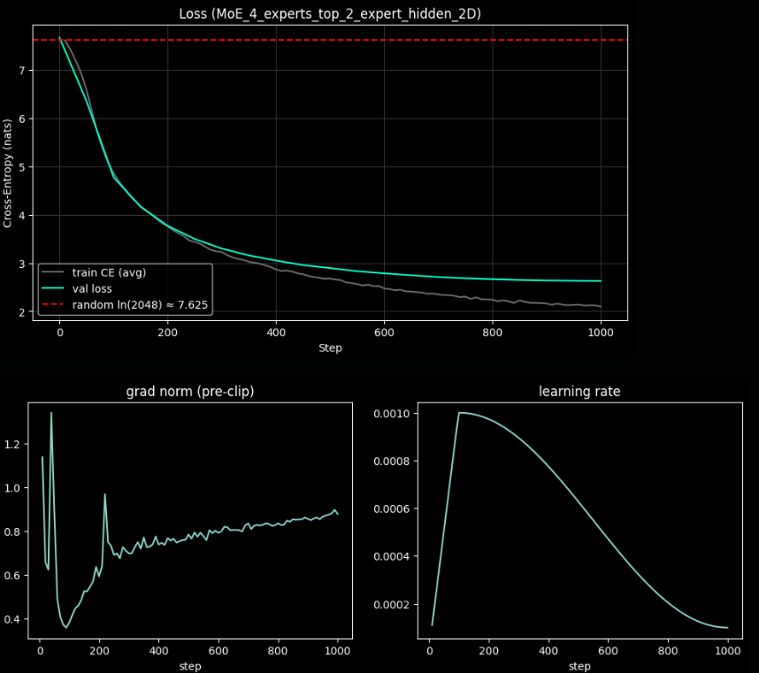

From Matrix to Mind: Core of Modern AI Explained w/ code and animation

## Abilation studies

the MoE is **parameter-matched to dense_8D** (9.90 M vs 9.90 M) and 
**active-FLOP-matched to dense_4D** (top-2 × 512 = 1024 hidden = dense 4D's FFN width). 
It beats both: 
val 2.628 vs 2.696 (dense 4D) and 2.709 (dense 8D). (needs larger & longer runs to rule-out noise!!!)
claim: *more capacity at the same per-token compute, and better than just spending the capacity densely*

### Notes:

| Quantity | Value |
|---|---|
| Dense 4D baseline params (D=256, V=2048, L=5, 4q/2kv heads, GLU hidden 1024) | **5,966,592** |
| Dense 8D params (GLU hidden 2048) | **9,898,752** |
| MoE, 4 experts × hidden 512 (2D), top-2 | **9,903,872** (= dense 8D + 1,024 router weights per layer × 5) |
| Attention params / layer (fused QKV + W_o) | 196,608 |
| KV cache per lane, fp32, GQA (2 kv heads) | 2.5 MiB (MHA would be 5 MiB) |
| Tokens seen in 1000 steps | 16,384,000 |
| Slowest RoPE frequency (θ=10000, head_dim 64) | ≈ 1.3 × 10⁻⁴ rad/token; fastest = 1 rad/token |
| Random-guess loss | ln 2048 = 7.625 (step-0 val ≈ 7.67, which is a good sanity story) |

* the divergence of validation and training lines indicates the model entering an overfitting regime.

similar behavior was observed in plots of other model variants. 
probably due to small data size

* ~16.4 M tokens seen (32 × 512 × 1000) on a 10Mb text file. If that's ~5 M tokens, 
I'm doing ~3 epochs, so train/val behaviour (e.g. dense_8D has lower train loss than dense_4D 
but worse val) may reflect repetition.

* the sliding KV cache needs a fixed attention sink or perf degrades past ctx_windw.

* fused layouts break tensor parallelism. W_qkv = [q|k|v] and [gate|up] are great on one GPU. 
But sharding their columns naively gives some ranks all-gate and others all-up, or splits heads wrongly. 
will need per-head interleaved layouts or separate matrices.

* MoE capacity dropping leaks information across tokens during training: The pair ordering is 
slot-major (a = slot * N + token). A token’s second-choice position is therefore counted after every 
token’s first choice, including tokens that come later in the sequence. Whether token t’s second expert 
is kept depends on what future tokens routed to, which is a small information leak from the future.
a known property of GShard/Switch-style routing.

* due to a small dataset size and constrained hardware, core performance differences among model architecture 
variants are noisy.

* MoE trains with capacity dropping (cf=1.25) but evaluates drop-free (C=N). Train and eval paths differ.

---

## what I got wrong initially -> how I fiexd them:

chunked prefill(where the cache already holds tokens & q_len > 1) mask generation was tricky 
-> 

maintaining absolute RoPE positions for sliding KV cache was tricky too. 
-> 

MoE python loop optimization
-> 
    

------

## Reasons for tests:
there are places where the logic can silently fail w/o raising errors, keep training & generate plausable text, yet it caps the max possible performance... silent killers!

go to: !

---

## TODO:

* 100MB and 1GB TinyStories training sets, 10MB and 100MB test sets respectively.

* table of ablations (RoPE vs. none, GQA ratios, tied vs. untied embeddings, with seeds and error bars)

* Compare naive recompute (batched_simple_inference), cached decode, and the continuous-batching scheduler in tokens/sec

---

## what I'd do next:

Image processing Transformer that completes MNIST puzzles:

each sample is a canvas with two MNIST digits 

* if only the top layer of pixels are white     -> right digit =  (left digit + 1) mod 10
* if the top & bottom layer of pixels are white -> right digit =  (left digit + 2) mod 10

then add "block corruptions" to the image & train on fixing them w/ MSE loss,
using bi-directional MHA & 2D RoP

